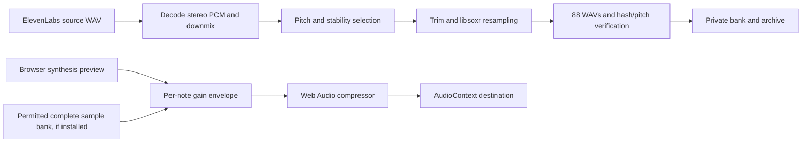

# Audio engineering and ElevenLabs prompt ledger

This is the operational reference for the application's sound, including the exact
prompts used, offline production, browser synthesis/sampling, transport, MIDI,
microphone analysis and verification boundaries. Parameters below describe the
implementation at commit `3e04910`; changing code requires updating this ledger.
No new ElevenLabs generation was needed to write this documentation.

- [Current delivery](#current-delivery) and [distribution restriction](#distribution-restriction).
- [Generation commands](#full-bank) and [listening review](#listening-review).
- [Complete prompt ledger](#complete-prompt-ledger).
- [Actual source selection](#actual-source-selection).
- [Offline DSP and validation](#offline-dsp-and-validation).
- [Browser audio engine](#browser-audio-engine).
- [Timing and score synchronization](#timing-and-score-synchronization).
- [MIDI and microphone](#midi-and-microphone).
- [Reproduction, troubleshooting and change control](#reproduction-troubleshooting-and-change-control).

## Current delivery

A private 88-key ElevenLabs-derived bank was created on 2026-11-06: A0–C8,
MIDI21–108, WAV PCM16 mono at 44.1kHz. All 88 files passed automated pitch,
silence/clipping and SHA-256 checks; maximum measured deviation is 2.998 cents.
Seventeen generated source recordings were cached; eleven passed source selection.
Every final key records its source, measured fundamental and resampling ratio.
Listening review remains pending, especially for extreme transpositions.

The bank lives in ignored `storage/audio-bank/elevenlabs-piano`. A private ZIP,
including the original source WAVs, is available in the workspace artifacts folder.
Neither the ZIP nor recordings are committed. The public app's manifest stays
empty and its synthesized preview remains explicitly labeled.

## Distribution restriction

[ElevenCreative terms, Exhibit 4 §2](https://elevenlabs.io/creative-terms) permit
incorporation into applications subject to their terms, but expressly restrict
making Sound Effects available as isolated audio files/samples or sound libraries.
A paid Creator plan was observed during generation; that does not remove this
restriction. These recordings are not relicensed MIT. Do not publish the bank,
raw sources or private ZIP in the open source repository or a public sample URL.
Obtain written permission for that distribution, or select an appropriately
licensed alternative for the public app. The generation code remains MIT.

## Private credentials

Use Bun 1.4.4 and FFmpeg with libsoxr on a trusted development machine. Configure
`ELEVENLABS_API_KEY` in the environment or ignored `.env`; never in Vite, frontend
props, committed files or reports. No key is needed to play an existing WAV or
verify the private bank. Cached source files also permit offline reconstruction.

Check presence without printing the value:

```sh
bun -e 'console.log(Boolean(process.env.ELEVENLABS_API_KEY) ? "configured" : "missing")'
```

The maintainer explicitly authorized creating the application audio. Every command
still requires a finite request limit and skips cached source responses. The CLI
never automatically repeats a billed request. A limit bounds calls, not currency
cost. Ordinary application playback never calls ElevenLabs. The exposed chat key
can be revoked after generation; it is absent from Git and the private ZIP.

## Full bank

Preview the source anchors without requests:

```sh
bun run audio:bank
```

Generate missing source anchors and build all 88 keys:

```sh
bun run audio:bank --generate --limit 17
bun run audio:verify
```

The source anchors span the keyboard. The CLI requests three-second isolated piano
notes using `eleven_text_to_sound_v3` and `wav_44100`, preserving the raw response
before validation. WAV headers identify stereo channels correctly; downmix keeps
the original time scale. Cached invalid responses remain available for inspection,
without silently charging for a replacement. Authentication/rate-limit errors stop
new requests. Source stability is checked over three analysis windows.

Generative prompts do not guarantee the requested pitch. The offline processing
therefore measures each source, selects a nearby usable source for each key, trims
leading silence and uses libsoxr resampling to tune it. Up to four offline passes
refine the estimate; the final bank targets an absolute error below 5 cents.
There is no synthetic replacement in these files. Pitch shifting changes decay
and can introduce perceptual artifacts at large intervals; automated fundamental
checks cannot establish artistic quality or exclude every unwanted overtone.

All 88 WAVs are staged and checked before the final private manifest is replaced.
`provenance.json` records hashes, source mapping, adjustments and pending listening
review. `verification.json` records the measured integrity/pitch result. Keep the
original sources and these records when archiving the bank.

## Individual notes and strict audit

A single-note command remains available for controlled experiments:

```sh
bun run audio:generate --from 60 --to 60 --limit 1 --generate
bun run audio:generate --from 60 --to 60 --limit 1 --generate --retune
```

The first command applies the strict 20-cent audit to the generated pitch; the
second explicitly enables offline correction. Results go to ignored
`storage/audio-bank/individual`, never public assets. Failed results remain cached
and reported. Missing individual source responses require the API key.

## Listening review

Listen to every final key for piano timbre, extraneous notes/noise, onset, decay
and consistent dynamics. Record that review separately from pitch checks. The
roadmap's listening/distribution assertions remain open. No billed generation or
human listening approval is claimed merely because an application build passes.

## Sound inventory and signal paths

The current product produces pitched piano notes for lessons, reading exercises,
the SVG keyboard, chord/harmony exploration and score playback. Chords, intervals,
scales and pieces are combinations of note events; they do not require a separately
generated recording for every chord or score. There are no generated narration,
voice, notification, success/error jingles or dedicated metronome assets in this
delivery. Microphone input is analyzed locally and is not mixed into the output.

The two sound sources are independent:

1. The public application currently uses its labeled additive synthesis preview.
2. The completed private bank contains ElevenLabs-derived recordings, processed
   offline. It is not deployed or automatically enabled in the public application.



The conditional sample path describes engine capability, not permission to publish
the current private bank. Application code and private generated audio have
separate distribution terms.

## Complete prompt ledger

### Request settings and generation history

Every generation used `eleven_text_to_sound_v3`, `duration_seconds: 3`,
`prompt_influence: 1` and `loop: false`. The model seed was not set or recorded;
repeating a prompt is not expected to reproduce identical audio. Raw source hashes,
not the prompt alone, identify the recordings used by this bank.

| Field              | Initial pilots              | Current source generation   |
| ------------------ | --------------------------- | --------------------------- |
| Method             | POST                        | POST                        |
| Endpoint           | `/v1/sound-generation`      | `/v1/sound-generation`      |
| Output query       | `output_format=pcm_44100`   | `output_format=wav_44100`   |
| Model              | `eleven_text_to_sound_v3`   | `eleven_text_to_sound_v3`   |
| Duration requested | 3 seconds                   | 3 seconds                   |
| Prompt influence   | 1                           | 1                           |
| Loop               | false                       | false                       |
| Request timeout    | 60 seconds                  | 60 seconds                  |
| Authentication     | Private `xi-api-key` header | Private `xi-api-key` header |
| Content type sent  | `application/json`          | `application/json`          |

The two initial PCM pilots both requested MIDI60/C4 using the same historical
prompt below. Neither was admitted to the finished bank. The later WAV stage
created seventeen distinct source anchors, including the C4 pilot subsequently
reused from cache. Reprocessing those sources did not generate eighty-eight new
API recordings. A final run's `requestsThisRun: 0` means that run used the cache;
it does not mean the original sources were free or never requested.

### Historical PCM prompt — MIDI60, used twice

Exact expanded text:

```text
One single isolated classical acoustic grand piano key, MIDI note 60, fundamental exactly 261.6256 Hz, tuned A4=440Hz. Immediate clean attack, natural decay. No chords, melody, voices, pedal, background noise or reverb.
```

The historical template substituted the MIDI number and `frequency(midi).toFixed(4)`.
Only MIDI60 was requested with this version in this delivery. Its mention of both
the target pitch and A4 added ambiguity; the revised prompt names one pitch only.
This is a prompt-design decision, not proof of what caused the model's deviation.
The initial raw-PCM path also assumed a mono layout and rejected the stereo-sized
response. Raw bytes alone did not make that layout unambiguous, motivating WAV.

### Current WAV template

`note` comes from the literal array `C, C sharp, D, E flat, E, F, F sharp, G, A flat,
A, B flat, B`; the octave is `floor(midi / 12) - 1`. The target frequency is
`440 * 2 ** ((midi - 69) / 12)`, printed with three decimal places.

```text
One isolated acoustic concert grand piano note: {note}{octave}, fundamental {frequencyHzTo3Decimals} Hz. A single key struck once at the very beginning, followed only by its natural decay. Dry close microphone, classical piano timbre. Absolutely no other notes, melody, chords, voice, pedal, noise or reverb.
```

The exact seventeen expanded prompts follow. They were captured from the current
request builder using a local request stub, so documenting them did not call the
provider. A requested label is not a measurement of the returned recording.

#### WAV MIDI21 — A0

```text
One isolated acoustic concert grand piano note: A0, fundamental 27.500 Hz. A single key struck once at the very beginning, followed only by its natural decay. Dry close microphone, classical piano timbre. Absolutely no other notes, melody, chords, voice, pedal, noise or reverb.
```

#### WAV MIDI27 — E♭1

```text
One isolated acoustic concert grand piano note: E flat1, fundamental 38.891 Hz. A single key struck once at the very beginning, followed only by its natural decay. Dry close microphone, classical piano timbre. Absolutely no other notes, melody, chords, voice, pedal, noise or reverb.
```

#### WAV MIDI33 — A1

```text
One isolated acoustic concert grand piano note: A1, fundamental 55.000 Hz. A single key struck once at the very beginning, followed only by its natural decay. Dry close microphone, classical piano timbre. Absolutely no other notes, melody, chords, voice, pedal, noise or reverb.
```

#### WAV MIDI39 — E♭2

```text
One isolated acoustic concert grand piano note: E flat2, fundamental 77.782 Hz. A single key struck once at the very beginning, followed only by its natural decay. Dry close microphone, classical piano timbre. Absolutely no other notes, melody, chords, voice, pedal, noise or reverb.
```

#### WAV MIDI45 — A2

```text
One isolated acoustic concert grand piano note: A2, fundamental 110.000 Hz. A single key struck once at the very beginning, followed only by its natural decay. Dry close microphone, classical piano timbre. Absolutely no other notes, melody, chords, voice, pedal, noise or reverb.
```

#### WAV MIDI51 — E♭3

```text
One isolated acoustic concert grand piano note: E flat3, fundamental 155.563 Hz. A single key struck once at the very beginning, followed only by its natural decay. Dry close microphone, classical piano timbre. Absolutely no other notes, melody, chords, voice, pedal, noise or reverb.
```

#### WAV MIDI57 — A3

```text
One isolated acoustic concert grand piano note: A3, fundamental 220.000 Hz. A single key struck once at the very beginning, followed only by its natural decay. Dry close microphone, classical piano timbre. Absolutely no other notes, melody, chords, voice, pedal, noise or reverb.
```

#### WAV MIDI60 — C4

```text
One isolated acoustic concert grand piano note: C4, fundamental 261.626 Hz. A single key struck once at the very beginning, followed only by its natural decay. Dry close microphone, classical piano timbre. Absolutely no other notes, melody, chords, voice, pedal, noise or reverb.
```

#### WAV MIDI63 — E♭4

```text
One isolated acoustic concert grand piano note: E flat4, fundamental 311.127 Hz. A single key struck once at the very beginning, followed only by its natural decay. Dry close microphone, classical piano timbre. Absolutely no other notes, melody, chords, voice, pedal, noise or reverb.
```

#### WAV MIDI69 — A4

```text
One isolated acoustic concert grand piano note: A4, fundamental 440.000 Hz. A single key struck once at the very beginning, followed only by its natural decay. Dry close microphone, classical piano timbre. Absolutely no other notes, melody, chords, voice, pedal, noise or reverb.
```

#### WAV MIDI75 — E♭5

```text
One isolated acoustic concert grand piano note: E flat5, fundamental 622.254 Hz. A single key struck once at the very beginning, followed only by its natural decay. Dry close microphone, classical piano timbre. Absolutely no other notes, melody, chords, voice, pedal, noise or reverb.
```

#### WAV MIDI81 — A5

```text
One isolated acoustic concert grand piano note: A5, fundamental 880.000 Hz. A single key struck once at the very beginning, followed only by its natural decay. Dry close microphone, classical piano timbre. Absolutely no other notes, melody, chords, voice, pedal, noise or reverb.
```

#### WAV MIDI87 — E♭6

```text
One isolated acoustic concert grand piano note: E flat6, fundamental 1244.508 Hz. A single key struck once at the very beginning, followed only by its natural decay. Dry close microphone, classical piano timbre. Absolutely no other notes, melody, chords, voice, pedal, noise or reverb.
```

#### WAV MIDI93 — A6

```text
One isolated acoustic concert grand piano note: A6, fundamental 1760.000 Hz. A single key struck once at the very beginning, followed only by its natural decay. Dry close microphone, classical piano timbre. Absolutely no other notes, melody, chords, voice, pedal, noise or reverb.
```

#### WAV MIDI99 — E♭7

```text
One isolated acoustic concert grand piano note: E flat7, fundamental 2489.016 Hz. A single key struck once at the very beginning, followed only by its natural decay. Dry close microphone, classical piano timbre. Absolutely no other notes, melody, chords, voice, pedal, noise or reverb.
```

#### WAV MIDI105 — A7

```text
One isolated acoustic concert grand piano note: A7, fundamental 3520.000 Hz. A single key struck once at the very beginning, followed only by its natural decay. Dry close microphone, classical piano timbre. Absolutely no other notes, melody, chords, voice, pedal, noise or reverb.
```

#### WAV MIDI108 — C8

```text
One isolated acoustic concert grand piano note: C8, fundamental 4186.009 Hz. A single key struck once at the very beginning, followed only by its natural decay. Dry close microphone, classical piano timbre. Absolutely no other notes, melody, chords, voice, pedal, noise or reverb.
```

## Actual source selection

The seventeen requested anchors span A0–C8, but the eleven admitted recordings'
measured fundamentals span only about 331.657–660.223Hz. Most returned pitches were
near the middle register regardless of their requested names. This is not an
88-note acoustic-piano recording session, nor proof that the model followed the
requested keyboard registers.

Eleven recordings formed the usable candidate pool; eight of those were actually
selected for the final bank. The other three remained available as candidates.
The table records the completed bank's provenance, not a promise about future
model responses. Frequencies are estimator results rounded here to three decimals.

| Requested MIDI | Requested note | Target Hz | Source measured Hz | Selection result               | Final keys using source |
| -------------- | -------------- | --------- | ------------------ | ------------------------------ | ----------------------- |
| 21             | A0             | 27.500    | —                  | No stable fundamental found    | 0                       |
| 27             | E♭1            | 38.891    | —                  | Tuning rejected: -21.2 cents   | 0                       |
| 33             | A1             | 55.000    | 439.084            | Candidate accepted             | 0                       |
| 39             | E♭2            | 77.782    | 331.657            | Candidate accepted             | 44                      |
| 45             | A2             | 110.000   | 440.471            | Candidate accepted             | 0                       |
| 51             | E♭3            | 155.563   | —                  | No stable fundamental found    | 0                       |
| 57             | A3             | 220.000   | 440.519            | Candidate accepted             | 1                       |
| 60             | C4             | 261.626   | 527.622            | Candidate accepted             | 4                       |
| 63             | E♭4            | 311.127   | 332.401            | Candidate accepted             | 2                       |
| 69             | A4             | 440.000   | 440.519            | Candidate accepted             | 0                       |
| 75             | E♭5            | 622.254   | 659.983            | Candidate accepted             | 2                       |
| 81             | A5             | 880.000   | 439.852            | Candidate accepted             | 1                       |
| 87             | E♭6            | 1244.508  | 660.223            | Candidate accepted             | 32                      |
| 93             | A6             | 1760.000  | 436.612            | Candidate accepted             | 2                       |
| 99             | E♭7            | 2489.016  | —                  | Changing source pitch rejected | 0                       |
| 105            | A7             | 3520.000  | —                  | No stable fundamental found    | 0                       |
| 108            | C8             | 4186.009  | —                  | No stable fundamental found    | 0                       |

Actual cumulative resampling ratios range from 0.084295388 to 6.323047982, approximately
−42.82 to +31.93 semitones. Forty-four keys use source39 and thirty-two use source87;
the remaining twelve keys use six other sources. These large shifts are a major
timbre/transient limitation, even though the measured final pitches meet the
frequency criterion. The bank must not be described as independently recorded
natural piano timbres across the whole keyboard.

## Offline DSP and validation

### Pitch and time conventions

Written spelling and sounding MIDI remain separate. Scientific octave numbering
is fixed: MIDI60=C4, MIDI69=A4=440Hz. English and fixed-do Portuguese labels change
names, not frequencies. Equal temperament uses:

```text
f(midi) = 440 * 2^((midi - 69) / 12)
errorCents = 1200 * log2(measuredHz / targetHz)
```

Positive cents mean sharp; negative cents mean flat. One semitone is 100 cents.
The final private-bank verifier requires an absolute measured error of at most
5 cents; the achieved maximum was 2.997680080749316 cents. The older strict
individual-note audit and browser manifest acceptance use a 20-cent bound. These
are deliberately different gates; the current bank passed the tighter gate.

### WAV decoding and mono conversion

`pcmFromWav` checks RIFF/WAVE identifiers, declared file size, bounded chunks and
16-bit PCM metadata. It accepts one or two channels at 44100Hz and validates frame
alignment, with a 50ms–8s decoded-duration bound. The chunk loop rejects excessive
chunks and truncated payloads; unsupported codecs/sample rates fail explicitly.
A maximum 2MiB response bound precedes preservation/decoding.

Stereo conversion computes `round((left + right) / 2)` for each signed little-endian
16-bit frame. It preserves frame count, sample rate, duration and nominal pitch;
it does not concatenate/interleave channels into a mono timeline. There is no
phase alignment or stereo widening. Out-of-phase channels can cancel during
averaging, so listening and the subsequent signal checks remain necessary.

Raw WAV responses are preserved before validation using an independent byte copy.
A preservation callback cannot mutate the bytes being decoded. Invalid responses
remain cached; the generator does not silently delete them and rebill the request.
Source file names identify the requested MIDI, not the actual generated pitch.

### Onset, level and pitch-estimation gates

Samples are converted to floating point with `signedInt16 / 32768`. Levels refer
to digital full scale, not physical loudspeaker volume.

| Stage                               | Implemented threshold or window                          |
| ----------------------------------- | -------------------------------------------------------- |
| Source clipping rejection           | Absolute sample peak greater than 0.995                  |
| Onset search                        | Non-overlapping 64-sample blocks, RMS greater than 0.008 |
| Onset block duration                | About 1.45ms at 44100Hz                                  |
| Offline estimator silence gate      | RMS below 0.004 produces no estimate                     |
| Initial source analysis offsets     | 30ms,120ms and240ms after onset                          |
| Slice supplied per estimate         | Up to one second of source audio                         |
| Estimator comparison count          | At most4096 samples, plus lag support                    |
| Nominal lag search                  | About20–4500Hz                                           |
| YIN normalized-difference threshold | Below0.12, followed to a local minimum                   |
| Source stability                    | Each offset estimate within 45 cents of the first        |
| Strict final-note audit             | Absolute error no more than 20 cents                     |
| Strict final-note attack            | Onset no later than350ms, then trimmed                   |
| Bank refinement goal                | Return within 3 cents; last pass may accept up to 5      |
| Offline refinement limit            | Four processing passes; no additional API call           |

The estimator uses the cumulative normalized squared difference between samples
separated by a candidate lag, then parabolic interpolation around its minimum.
It is YIN-style periodicity estimation, not selection of the largest FFT bin.
A one-second input slice does not mean every sample in that second is analyzed:
the comparison loop is capped at 4096. The source-selection routine first trims
its detected onset; the strict post-processing audit checks the resulting file's
attack and trims again when needed.

The peak 0.995 threshold is about −0.044dBFS. Onset RMS 0.008 is about −41.94dBFS;
the estimator's 0.004 gate is about −47.96dBFS. These checks can detect silence,
obvious clipping and unstable periodicity, but cannot prove isolated piano timbre,
absence of all background sound, perceived loudness or unambiguous fundamental.
The peak check runs on the downmixed signal; it does not independently certify
that each original stereo channel was unclipped, or measure inter-sample true peaks.
Piano overtones, inharmonicity, octave errors and polyphony can mislead a periodicity
estimator. Reverification uses the same estimator, not an independent acoustic
certification.

### Tuning and resampling

For each final key, candidates are sorted by absolute logarithmic frequency
distance to the target, using measured source frequency. If processing a candidate
fails, the next cached candidate is tried without calling the provider. The
resampling ratio for each pass is `targetHz / measuredHz`.

The actual FFmpeg invocation uses the following structure; `INPUT_RATE` is
`round(44100 * ratio)` and stdin/stdout carry mono signed16-bit little-endian PCM:

```sh
ffmpeg -hide_banner -loglevel error -nostdin \
  -f s16le -ar INPUT_RATE -ac 1 -i pipe:0 \
  -af 'aresample=44100:resampler=soxr,atrim=duration=6,afade=t=out:st=5.9:d=0.1' \
  -f s16le -ar 44100 -ac 1 pipe:1
```

Interpreting the source at the adjusted rate changes pitch and speed; libsoxr then
converts it back to 44100Hz with band-limited resampling. This is not independent
time stretching or formant preservation. A downward shift lengthens the attack and
decay; an upward shift shortens them and moves the spectral envelope. It does not
simulate the construction, string inharmonicity or resonances of a naturally
recorded key in the new register.

Each pass caps output at six seconds and applies a 100ms fade beginning at 5.9s.
A clip shorter than 5.9s does not reach that fade. Final files in this bank last
approximately 0.473–6.000s. Playback's gain envelope is an additional runtime gate;
a long held note does not lengthen the recorded sample or create a sustain loop.
When a strict audit fails on tuning, the processor can estimate the residual
frequency and retry offline. Other failures reject the candidate. The product of
all pass ratios is recorded as `resamplingRatio`.

There is no offline LUFS/EBU-R128 mastering, peak normalization, equalization,
denoising, de-reverberation, convolution, compression, velocity-layer recording,
round-robin sampling, release sampling or sympathetic-resonance modeling. Do not
infer those processes from the words “classical piano” in the prompt. Differences
in source level/timbre and extreme shifts still require listening review.

### Integrity and atomicity

The source hash identifies the exact generated input. Per-key provenance records
requested source MIDI, source hash/fundamental, onset, cumulative ratio, final
frequency/cents, final hash and byte count. Final WAVs are PCM16 mono 44100Hz with
a 44-byte WAV header written by `wavFromPcm16`.

All keys are prepared in `storage/audio-sources/bank-staging` before publishing
the private manifest. Final WAVs are renamed into the private output directory;
then provenance is written and the manifest temporary file is renamed last.
This is not a single filesystem transaction for the entire directory: a failure
between individual renames can leave a mixed file set under an old manifest.
Always rerun `audio:verify` before use or archiving; hashes detect that mismatch.
The pipeline does not advertise a successfully completed bank after a failed key.

The verifier checks 88 distinct IDs covering 21–108, manifest/schema expectations,
every final SHA-256, pitch remeasurement within 5 cents and agreement with stored
cents within 0.01. The measured result is 28,202,880 bytes of WAV data. It does not
replace review of every source's licensing, microphone acoustics or perceptual
quality. Private raw sources are needed to reproduce the exact timbre; a prompt
and model name alone cannot reconstruct it deterministically.

## Browser audio engine

### Loading and fallback

`PianoAudio.prepare()` creates an `AudioContext` on a user action, resumes it when
suspended and loads the same-origin manifest once per engine instance. Valid
sample entries require integer MIDI21–108, the exact URL
`/audio/piano/<midi>.wav`, `validated: true`, positive finite frequency and the
20-cent tuning bounds. All declared files are fetched and decoded in parallel.
Sampling activates only when the resulting map has 88 unique keys. A partial bank
keeps synthesis mode; loading/decoding failure also sets the fallback state.

The source file sample rate is 44100Hz; `AudioContext` uses the browser/device's
chosen sample rate, which can differ. Browser decoding/resampling handles that
boundary. The engine does not request a fixed hardware sample rate or expose
ASIO-style device/buffer controls. Decoded buffers are cached per engine, not in
a shared application-wide buffer cache. There is no streaming/eviction scheme.
For this bank, float32 decoded mono data alone would occupy about 56.4MB, in
addition to fetched/temporary buffers and browser overhead. That is an estimate,
not a measured mobile memory benchmark; the bank is not currently installed.

Public playback does not call ElevenLabs or send its key. The runtime manifest
validator does not perform SHA-256 checks on decoded audio: hash verification is
an offline bank-production step. Fetch/decode failures and a complete-bank check
are runtime defenses. Do not claim runtime cryptographic sample verification.

### Synthesis preview and signal chain

The preview builds four sine oscillators per note:

| Harmonic number | Frequency | Relative gain |
| --------------- | --------- | ------------- |
| 1               | `hz`      | 0.55          |
| 2               | `2 * hz`  | 0.24          |
| 3               | `3 * hz`  | 0.10          |
| 4               | `4 * hz`  | 0.04          |

Each partial connects to the note's gain node. A sampled voice instead uses an
`AudioBufferSourceNode` connected to that same gain node. Both pass through the
engine's shared `DynamicsCompressorNode` and then the context destination. The
preview is an additive approximation; it is not a physical piano model or an
ElevenLabs recording. There is no added reverb or stereo spatialization in this
engine.

For the envelope, let `v = clamp(volume, 0, 1)`. The note envelope is:

1. Gain starts at zero at `max(requestedTime, context.currentTime)`.
2. Linear attack reaches `0.32 * v` after 8ms.
3. Exponential decay reaches `max(0.0001, 0.12 * v)` at
   `max(30ms, 0.8 * duration)` after the note start.
4. Exponential release reaches 0.0001 at `duration + 80ms`.
5. Sources stop at `duration + 100ms` and disconnect on completion.

This is a percussive envelope, not a constant sustain-level ADSR or a calibrated
piano dynamics model. A manual stop cancels scheduled gain automation, targets
zero with an 8ms time constant and stops sources 40ms later. This reduces abrupt
clicks but is not a guarantee of click-free output for every waveform/device.
Volume scales amplitude; MIDI velocity does not select different timbre layers.

| Compressor parameter | Value |
| -------------------- | ----- |
| Threshold            | −9dB  |
| Knee                 | 6dB   |
| Ratio                | 20:1  |
| Attack               | 1ms   |
| Release              | 150ms |

This is Web Audio dynamics compression, not a measured true-peak brickwall limiter,
a loudness-normalization pass or a sound-pressure safety guarantee. Output level
also depends on OS gain, speakers/headphones and the listener's hardware.

### Polyphony, chords and tuning

The advanced transport limits simultaneous voices to 32 and scales each event's
volume by `event.velocity / max(1, simultaneousVoices)`. The harmony explorer
starts every chord tone at the same context time, uses `1 / chordSize` per voice
and a 1.5-second gate; its visual clear timeout is 1600ms. The original monophonic
lesson transport uses the default note volume. These amplitude rules mitigate
summation, but do not guarantee equal perceived loudness for every voicing.

Equal temperament uses A4=440Hz. Alternate “just-c” and “pythagorean-c” modes
anchor C4 to its equal-tempered frequency and apply fixed chromatic ratios with
octave scaling. A4 can therefore differ from 440Hz. They are teaching comparisons,
not adaptive just intonation for arbitrary tonal context. `tuning.ts` contains
the exact ratio arrays. Transposition changes sounding MIDI while the written
pitch remains available for engraving. Unsupported/range-exceeding performance
options fail rather than silently creating an out-of-range voice.

For a sample, `playbackRate = requestedHz / equalTemperedFrequency(midi)`. This
adjusts tuning/speed together and does not compensate for a sample's remaining
measured few-cent error. For synthesis, the requested frequency directly sets the
four oscillators' fundamentals/partials. A finite sample is never looped to fill
a longer note; its natural end can precede the event's logical note-off.

## Timing and score synchronization

The audio clock is `AudioContext.currentTime`. Musical durations are rational
fractions of a whole note, converted to quarter beats and seconds at the selected
quarter-note BPM: `seconds = quarterBeats * 60 / BPM`. Rests occupy time without
a voice. Ties join contiguous compatible notes into one sounding event.

Both transports use 40ms of initial scheduling lead. The original lesson transport
schedules its remaining timeline at once. The advanced transport schedules a 150ms
lookahead from a `requestAnimationFrame` loop; actual oscillator/buffer start times
are placed on the Web Audio clock. Animation frames read the clock to derive
playhead and active score/piano notes. Imported normal notes use a 0.98 gate factor
and staccato a 0.5 factor; source-realized curated MIDI gates are retained. Printed
tempo changes and full expressive/pedal interpretation are not silently applied.

Pause stores the musical time offset and cancels voices. Resume respects remaining
event ends but retriggers a still-active sample from its beginning; it does not
resume an `AudioBufferSourceNode` at the original waveform offset. Stop resets the
timeline. Score/tempo/advanced tuning changes invalidate pending playback tokens.
Navigation/unmount cancels voices and closes the engine. Hidden tabs pause score
transport; the advanced player additionally pauses on window blur. Manual input
releases held keys on blur, and instrument input has its own cleanup described
below.

Score SVG note IDs/time positions and piano highlights follow the scheduled
musical state, not pixel distances. The harmony explorer's 1.6-second highlight
is a timer-based chord demonstration, not a score cursor. Device output latency,
Bluetooth delay, animation cadence and background-thread load can still separate
visible and audible arrival. No acoustic end-to-end latency measurement or
speaker/display calibration has been performed; passing browser tests is not
sample-accurate hardware synchronization certification.

## MIDI and microphone

### MIDI input

Web MIDI is opt-in with `sysex: false` and feature detection. Note-on velocity is
normalized by 127; note-on with zero velocity is note-off. Input is limited to
MIDI21–108. Device, channel and pitch identify each active input voice. Repeated
note-ons replace the old voice; a 32-voice cap removes the oldest retained entry.
MIDI playback uses a 30-second maximum logical gate and `velocity * 0.35` before the
engine envelope. Instrument-page manual keys use an 8-second gate and volume 0.5;
other practice views have their own shorter manual gates.

CC64 values at least 64 hold released notes until the pedal rises. This extends
logical note lifetime, not a physical damper/sympathetic-resonance simulation,
and cannot extend a finite unlooped sample. CC120/123 reset the instrument engine.
Disconnects, blur, hidden tabs and navigation stop voices; background messages
cannot restart audio until focus returns. Unsupported browsers retain manual
input. Exact device/driver latency and velocity-response curves are not calibrated.

### Microphone capture and estimation

The user explicitly enables `getUserMedia`. Requested audio constraints disable
echo cancellation, noise suppression and automatic gain control; browser/hardware
may still impose processing. A separate `AudioContext` connects capture to an
`AnalyserNode` with 4096-sample buffers, without connecting the microphone to output.
No audio recording, upload, echo/monitor mix or server-side pitch analysis occurs.
The current device sample rate is used; it is not assumed to be 44100Hz.

The live detector searches roughly 80–1200Hz using a YIN-style normalized difference,
RMS gate 0.012 and a 0.1 local-minimum threshold. Its displayed confidence is
`max(0, 1 - normalizedDifference)`, not a calibrated correctness probability.
The UI accepts estimates only above 0.94 confidence and within 35 cents of the
nearest equal-tempered MIDI note, requiring three consecutive matching-MIDI
updates. Updates are throttled to more than 120ms apart. There is about 240ms between
the first and third accepted update, plus capture/window/device/processing delay;
this is a scheduling consequence, not a measured latency guarantee.

Noise, chords, overtones, instrument timbre and octave ambiguity can defeat the
estimator. It is not a reliable polyphonic transcription/assessment system and
does not award correct exercise answers automatically. Stop, blur, hidden tabs
and navigation release capture tracks and close the analysis context; generation
tokens handle permission responses arriving after cancellation.

## Reproduction, troubleshooting and change control

| Symptom                                        | Inspection and action                                                                                                                  |
| ---------------------------------------------- | -------------------------------------------------------------------------------------------------------------------------------------- |
| No sound on first load                         | Use an explicit play/key gesture; check context suspension, browser/OS mute and device output                                          |
| UI says synthesized preview                    | Expected publicly; the private bank is not installed. Also inspect completeness/fetch/decode failures for a permitted bank             |
| Wrong generated pitch                          | Inspect measured frequency/provenance; prompts are not tuning guarantees. Reprocess cached input before requesting another paid source |
| Slow/dull low notes or short/bright high notes | Inspect resampling ratio and source frequency; this bank uses large register shifts. Review by listening, not cents alone              |
| Timing differs on Bluetooth                    | Compare wired output; record hardware latency separately from the audio-clock scheduler                                                |
| Microphone shows no estimate                   | Check permission, level, range, monophonic input and three-update confidence gate                                                      |
| Stuck MIDI highlight/sound                     | Use All notes off; inspect pedal state, repeated notes, focus and disconnect cleanup                                                   |
| Raw response fails decoding                    | Keep the cached original; inspect WAV fmt/channels/rate/chunk sizes instead of guessing raw PCM layout                                 |
| Hash verification fails                        | Do not use that bank; compare manifest/provenance and restore or rebuild from exact cached sources                                     |
| API401/403/429                                 | Stop new generation and resolve credentials/permissions/quota; do not blindly retry billed calls                                       |

Use `bun run audio:bank` for a dry run. `bun run audio:bank --generate --limit 17`
can make paid requests only for missing source WAVs; retain the cache to avoid
unnecessary requests. `bun run audio:verify` performs local integrity/pitch checks
without calling ElevenLabs. The generated private ZIP contains the source WAVs,
final WAVs, manifests, report and README, but no environment files or API key.
Do not publish those assets while the provider's distribution restriction applies.

| Source file                                                                                       | Responsibility                                                              |
| ------------------------------------------------------------------------------------------------- | --------------------------------------------------------------------------- |
| [scripts/lib/piano-samples.ts](../scripts/lib/piano-samples.ts)                                   | Request template/settings, WAV codec, pitch estimator and strict audit      |
| [scripts/lib/piano-processing.ts](../scripts/lib/piano-processing.ts)                             | Onset/source stability, iterative offline tuning and FFmpeg invocation      |
| [scripts/produce-piano-bank.ts](../scripts/produce-piano-bank.ts)                                 | Anchor budget/cache, source selection, 88-key staging and provenance        |
| [scripts/generate-piano.ts](../scripts/generate-piano.ts)                                         | Controlled individual-note generation/retuning and private results          |
| [scripts/verify-piano-bank.ts](../scripts/verify-piano-bank.ts)                                   | Complete-bank integrity/pitch verification report                           |
| [resources/js/music/audio.ts](../resources/js/music/audio.ts)                                     | Browser sample loading, synthesis, envelope, compressor and voice lifecycle |
| [resources/js/music/use-transport.ts](../resources/js/music/use-transport.ts)                     | Original lesson timeline transport                                          |
| [resources/js/music/use-performance.ts](../resources/js/music/use-performance.ts)                 | Advanced polyphonic scheduling and active-state calculation                 |
| [resources/js/music/musicxml.ts](../resources/js/music/musicxml.ts)                               | Rational event execution, gates, ties, repeats and performance limits       |
| [resources/js/music/tuning.ts](../resources/js/music/tuning.ts)                                   | Equal/fixed-C alternative frequency mappings                                |
| [resources/js/music/instruments.ts](../resources/js/music/instruments.ts)                         | MIDI message decoding and live microphone estimator                         |
| [resources/js/components/music/Instruments.tsx](../resources/js/components/music/Instruments.tsx) | Permissions, device lifecycle, sustain and microphone UI gates              |
| [tests/unit/audio.test.ts](../tests/unit/audio.test.ts)                                           | Signal/audit/WAV/API-request/manifest fixtures                              |
| [tests/e2e/extended.spec.ts](../tests/e2e/extended.spec.ts)                                       | Browser import/score/MIDI/microphone interaction checks                     |

Before updating a bank, preserve raw originals and both source/final hashes; record
model, exact prompt, request settings, source measurement and processing revision.
Change this document when thresholds, templates, gates, timing or licenses change.
Rerun source-specific unit checks and `audio:verify`, then conduct and record the
listening review. A code change alone does not update already-generated audio:
regenerate derived WAVs from the cache and archive their new provenance separately.
Never mark review/distribution tasks complete solely because type checks, pitch
checks or a build pass.

References: [Sound Effects API](https://elevenlabs.io/docs/api-reference/text-to-sound-effects/convert),
[Sound Effects output terms](https://elevenlabs.io/creative-terms).
